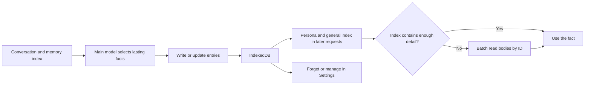

# AIRI memory research

Research date: 2026-11-05. This records the requested source investigation and
its implications for Cogita. It is a research reference, not an implementation
plan, an accepted API design, or a contract for implemented Cogita behavior.

## Scope and evidence

| Repository | Inspected revision | Role |
| --- | --- | --- |
| `moeru-ai/airi` | [`11b8989f6dd7f840cf6b15ce59e367656fb11ac6`][airi] | Main application, integrations, tests and architecture decisions |
| `moeru-ai/plast-mem` | [`611103456d953c9a74452f4239817b3468f94bba`][plast] | Related memory project explicitly referenced by an AIRI bridge contract |
| Cogita | `532d1d4e5d1cfa44b4553886d8cf321d6caf07c9` | Local contracts, context services, retrieval and behavioral tests |

Upstream links below are pinned to those revisions. Findings come from static
inspection and call-site searches, including test assertions. Upstream tests,
applications, databases and real-model inference were not run. A test present
in the source establishes intended coverage, not a measured acceptance result.
Statements about missing integration mean no active path was found in this scope.
Upstream source takes precedence where documentation describes a different state.

The principal opportunity is a managed layer of facts that survives individual
sessions. Cogita already has stronger context budgeting, source references and
checkpoint commit rules than AIRI's lightweight main-chat memory path. Those
mechanisms should remain the foundation of any future memory work.

## Capability map

| Component | Observed implementation | Boundary |
| --- | --- | --- |
| Main-chat long-term memory | Atomic fact entries, per-persona index, read/write/forget tools, IndexedDB and Settings | Active application path; no vector retrieval in this path |
| Main-chat recent history | Complete-turn window trimming | Context retention, independent of durable facts |
| Telegram integration | Message embeddings, relevant-message retrieval and surrounding-message expansion | Separate integration, not the main-chat memory store |
| Computer-use Task Memory | Goal, confirmed facts, artifacts, blockers and next step | Current session execution state, explicitly not long-term memory |
| `memory-pgvector` | Module client and empty configuration handler | Scaffold, not an implemented memory retrieval service |
| Short-term memory Settings | WIP component | A page name does not establish a working memory feature |
| Plast-Mem bridge | Ownership and proposed export/retrieval contract | Explicitly no runtime integration or dependency in this slice |

The [AIRI decision][airi-adr], [pgvector entry point][airi-pgvector],
[short-term page][airi-short-page] and [bridge contract][airi-bridge] make these
distinctions important: AIRI does not expose one completed, unified memory pipeline.

## Main-chat long-term memory lifecycle

### Selection and extraction

[Memory tools][airi-tools] instruct the conversation model to save only when
someone asks it to remember something or states a lasting fact. Most turns
should save nothing. The same model performs extraction through ordinary tool
calls; no separate background extraction model is present in this path.

The prompt asks for one fact per entry, updating an existing ID instead of
adding a near copy. It excludes material already held by a Recipe, the model's
own rules, codes, passwords and secrets. These are prompt instructions;
validation checks argument shape and length, not factual support or secrecy.

This approach avoids an extra extraction completion on every turn. Its quality
depends on the main model recognizing durable facts, distinguishing user claims
from its own guesses, and following the write/update policy.

### Entry model and tools

The [types][airi-types] contain `id`, `description`, `body`, optional `persona`
and `updatedAt`. Missing `persona` denotes a general entry. There is no
structured source-message reference, source-run reference, validity interval,
revision history, confidence field or embedding in this record.

| Tool | Input and effect |
| --- | --- |
| `builtIn_readMemory` | Reads a nonempty array of IDs; returns bodies of visible entries in one call |
| `builtIn_writeMemory` | Accepts a nonempty entry array; each entry has a required nullable ID, description and body |
| `builtIn_forgetMemory` | Removes one entry by ID if it belongs to the run's persona |

The write schema limits descriptions to 150 characters and bodies to 2000
characters. These are character limits, not token limits. The batch arrays
have no maximum length in these schemas. The store trims text and refuses an
empty body. A description may state a short fact directly; a long entry's
description should explain when the body is useful.

For example, an index line saying "Prefers concise English answers" can answer
a style question without a read. "Deployment constraints" would require
reading its body. This distinction saves unnecessary tool round trips.

### Persistence, loading and concurrent windows

The [repository][airi-repo] stores one record per ID in IndexedDB through
`unstorage`. It generates UUIDv7 IDs for new entries. Every write acquires the
`airi:memory` Web Lock and reads the current stored record inside that lock.

The [store][airi-store] reloads entries after mutation and broadcasts changed
IDs to other windows. Other windows reload from storage. Chat waits for
`memory.ready()` before preparing a send; this prevents an ordinary first-load
race from treating an unloaded index as an empty memory. The readiness method
catches load rejection, so it is not a guarantee that storage succeeded.

Reads use the window's loaded entries. Locks protect stored writes; they do
not make every prompt/read a fresh transactional snapshot. Entries are listed
by update time, and the prompt index groups own entries before general entries.

Deletion stores an ID/time tombstone instead of a live body. This supports
local synchronization semantics and a possible future device sync; it does
not establish implemented cross-device memory synchronization. AIRI also has
a legacy localStorage migration, which is not a pattern to import into Cogita's
disposable test-data architecture.

### Recall and prompt construction

[Chat wiring][airi-chat] appends the memory instructions and the complete
visible index to the session persona's system prompt. It binds memory tools
to that session's persona rather than accepting a target persona from the model.
The first request and subsequent model steps can rebuild the persona prompt.

Recall is directory navigation: the model sees IDs/descriptions, uses short
facts directly, and fetches selected bodies. There is no semantic search,
keyword ranking, reranking or automatic consolidation in this main-chat path.
The relatively stable prefix is intended to support prompt caching; no cache
performance measurements were made in this research.

All visible index entries are injected. The implementation does not impose a
memory-index token allowance, relevance cutoff or pagination. It therefore
fits small collections better than unrestricted accumulation of facts.

### Updates, conflicts and forgetting

Writing the ID of an existing own entry replaces that entry. Writing without
an ID creates one. Writing an unknown, deleted, general or other persona's ID
also creates a new own entry with a fresh ID. This protects the targeted
record but can produce duplicates or recreate similar content after deletion.

There is no semantic deduplication or contradiction engine. The model must
select the correct ID. The write lock prevents interleaved read/write races,
but two valid updates to the same own entry still have last-write semantics;
there is no expected-version check or retained prior fact.

Tool execution persists mutations immediately. No run-success staging,
whole-batch transaction or rollback on later generation failure was found.
No source-history edit/delete/retry invalidation path was found for these
facts. Forgetting is explicit, with no expiration or automatic decay.

### Scope and user control

A run can read its persona's entries and general entries. It can mutate only
its own entries. The owner can make an entry general in Settings; runs cannot
change or forget that general record. Scene and background sessions also get
memory tools bound to their persona.

[Settings][airi-memory-page] groups entries by card and exposes bodies,
deletion and promotion to general. It has no direct body-edit form or
promotion-back-to-private control at the inspected revision. A global switch
removes fresh index/tool injection without deleting records; it cannot erase
memory content already present in retained conversation history.

Persona scope alone does not establish separation between workspaces, channel
participants or scenes sharing a persona. General entries are available to
every card. The [ADR][airi-adr] separately records unresolved scene privacy
and unverified real-model/Discord/speech acceptance.

### Existing upstream test coverage

[Memory tool tests][airi-tool-tests] check read/write/forget callbacks, required
schema properties and prompt construction. [Browser store tests][airi-store-tests]
cover distinct generated IDs, update-by-ID, persona visibility, owner promotion,
protection of general entries, empty-body rejection, restart persistence and
cross-window changes. A concurrent removal/promotion test verifies that stale
windows cannot overwrite the protected record; it also permits fresh entries
from those stale writes, consistent with the duplicate risk described above.

[Chat contract tests][airi-chat-tests] verify scene-persona/general index
selection and removal of memory tools/index when disabled. These tests do not
establish extraction precision, contradiction resolution, long-run prompt cost
or real-model recall quality.

## Other AIRI memory paths

### Recent history and task state

The [chat runtime][airi-runtime] interprets its configured `contextWindow` as
a turn count. Negative/unset values retain history; zero keeps the current
input and system messages. When the positive limit is exceeded, trimming
keeps approximately 90% of that limit, preserving complete turns. This path
does not implement Cogita-style token-counted rolling factual summaries.

The exported [structured-history compactor][airi-compaction] can replace old
history blocks with summary text, but its default text only reports the
number of removed turns. Searches found its export/tests, not an active
main-chat summarization integration. Its name alone is not evidence of
automatic long-conversation factual retention.

Computer-use [Task Memory types][airi-task-types] separate goal, current step,
confirmed facts, artifacts, blockers, next step and optional assumptions or
completion criteria. The [manager][airi-task-manager] rejects stale updates
using source turn identity/index and renders a compact context snapshot.
This is useful working-state structure, not durable cross-session knowledge.

Recipes likewise represent reusable procedures. AIRI deliberately separates
them from remembered facts. Cogita should preserve ownership distinctions
between Persona instructions, tool workflows, facts and external Knowledge.

### Telegram historical-message retrieval

The [message model][airi-telegram-model] records messages and embeddings.
Photo/sticker descriptions can become searchable text. The schema has separate
vector columns for 768, 1024 and 1536 dimensions and HNSW cosine indexes.

The [read action][airi-telegram-read] performs the following chain:

1. Load the latest 30 messages for the requested chat.
2. Embed unread messages with text/captions individually.
3. Exclude already-known recent/unread IDs from candidate retrieval.
4. Search the current chat, require cosine similarity above 0.5, and take up
   to three candidates per query using similarity plus time relevance.
5. Expand each hit with up to five earlier and five later messages, and look
   up replied-to messages for rendering.
6. Format recent, unread and relevant historical messages for model context.

The useful idea is surrounding-message recovery. A hit such as "use the
second option" needs its earlier discussion to be meaningful. Cogita could
apply bounded expansion to complete history turns after a search hit.

Static findings prevent treating this implementation as a ready-made algorithm:

- `created_at` and current-time subtraction use milliseconds, but the time
  term divides by `86400` and `30` without converting milliseconds to seconds.
  The nominal 30-day scale is about 43.2 minutes, and the term can become
  negative. This is a source-level unit inconsistency, not a measured ranking result.
- Expanded windows from different hits/queries can overlap; the observed path
  has no final global deduplication and shared token budget.
- Embedding each unread message multiplies calls and candidates.
- The [schema][airi-telegram-schema] defines fragments, episodic extensions,
  goals and ideas, but no active use of those memory table exports was found
  outside their definitions. Tables alone do not establish consolidation.

## Plast-Mem: related architecture, not an AIRI integration

The [bridge contract][airi-bridge] assigns future project-level long-term
memory to Plast-Mem and current-run execution evidence to computer-use. It
explicitly excludes a dependency, API calls, automatic Task Memory export and
direct insertion into semantic-memory tables. Proposed retrieved content is
contextual evidence subordinate to current instructions and verified results.
Plast-Mem itself currently scopes memory through `conversation_id`; a future
project adapter would still need a deliberate scope mapping.

### Ingestion and episode formation

The [architecture][plast-architecture] describes persisted messages,
segmentation claims, committed episode spans, episode creation and subsequent
semantic consolidation. Worker claims and span checks reject stale jobs.

The [segmentation worker][plast-segmentation] calls temporal rules and LLM
review functions currently exported from [legacy.rs][plast-segmentation-policy].
Soft time boundaries start at 30 minutes; gaps over three hours are hard
boundaries. Small ranges are classified for information value, larger ones
can be split, and informative groups can undergo constrained boundary review.
Until end-of-input is declared, the last unresolved segment is carried forward.

The newer `EventSegmenter` is also exported, but its presence does not mean
the inspected worker uses it. Documentation still points to the removed
`batch_segmentation.rs` path. This is an example of why call sites matter.

[Episode creation][plast-episodes] derives a deterministic ID from conversation
and sequence range, preserves source messages, and renders a transcript grouped
by time. Optional LLM additions anchor existing relative-time expressions
without rewriting the original statement; a separate step generates a title.
It embeds the resulting content and initializes FSRS state.

The current path is not simply an LLM summary of every episode. It writes
`surprise = 0.0`, so the README's surprise-driven reinforcement is dormant.
Informative, unconsolidated episodes enqueue consolidation individually;
the README's older three-episode/flashbulb trigger is not this code path.

### Semantic consolidation

[Predict-calibrate][plast-consolidation] loads related active facts. With no
existing facts it extracts from the episode; otherwise it predicts episode
content from existing knowledge/title, then compares that prediction with
the actual episode to propose changes.

| Action | Stored effect |
| --- | --- |
| `new` | Insert a fact, or reinforce a near duplicate |
| `reinforce` | Add source-episode provenance to an existing active fact |
| `update` | Invalidate the old fact and insert or merge its replacement |
| `invalidate` | Mark the old fact inactive without requiring a replacement |

Facts have category, text, source episode IDs and `valid_at`/`invalid_at`.
Categories cover identity, preference, interest, personality, relationship,
experience, goal and guideline. Consolidation mutations use a transaction;
the episode's consolidated marker is written afterward. The model's action
schema contains confidence, but the durable fact schema does not store it.

The useful concept is explicit fact evolution with provenance. It does not
require Cogita to adopt the prediction stage, category taxonomy, similarity
thresholds or handling of unavailable update targets.

### Retrieval and review

[Semantic retrieval][plast-semantic] combines BM25 and vector ranks with RRF,
filtering inactive facts and optionally categories. [Episodic retrieval][plast-episodic]
uses the same broad pattern, then multiplies RRF score by FSRS retrievability.
SQL uses the vector negative-inner-product operator; descriptions of cosine
similarity should not be copied without checking embedding normalization.

The [retrieval API][plast-retrieval-api] separates full retrieval from semantic-only
`context_pre_retrieve`. Full retrieval may queue episodic review work; the
semantic-only pre-retrieval path does not. Later segmentation can schedule a
[review job][plast-review], where an LLM assigns Again/Hard/Good/Easy ratings
and FSRS updates stability/difficulty. Stale and same-day reviews are skipped.
Semantic facts do not decay through FSRS; they remain active until invalidated.

FSRS affects ranking, not physical deletion. Its benefit for engineering
facts is unproven here: an old constraint can remain critical despite infrequent
use. The project still describes itself as pre-0.1.0 with incomplete core
functionality. No operational or quality acceptance is claimed by this report.

## Implications for Cogita

Current ownership remains with [Chat/context](../contracts/chat-context.md),
[Harness/tools](../contracts/harness-tools.md#on-demand-history),
[Knowledge](../contracts/knowledge.md) and [QQBot](../contracts/qqbot.md).

| Concern | Existing Cogita mechanism | Research implication |
| --- | --- | --- |
| Context capacity | Every internal call enforces its model budget | Budget memory indexes and bodies through the same path |
| Conversation continuity | Rolling summaries, message windows and original-history retention | Keep these separate from durable facts |
| Working memory | Session memory and run progress checkpoints | Reuse commit/version principles, not the same cross-session store |
| Historical evidence | Bounded list/search/read tools with source IDs | Consider complete-turn expansion around search hits |
| Knowledge retrieval | Vector and keyword candidates, RRF, optional reranker | Reuse scoring/model services if fact volume requires search |
| Identity and isolation | Persona data, Project isolation and QQ conversation ownership | A reused Persona must not implicitly share project/channel facts |
| Durable learned facts | No independent managed cross-session fact lifecycle | Main missing capability identified by this investigation |

Relevant local implementation includes [history retrieval](../../ai_workbench/core/history_retrieval.py),
[context tools](../../ai_workbench/core/retrieval_tools.py),
[checkpoint schemas](../../ai_workbench/core/schema/retrieval.py),
[summary generation](../../ai_workbench/core/compaction_generation.py), and
[Knowledge retrieval](../../ai_workbench/core/retrieval.py).
[History tests](../../tests/test_history_retrieval.py) cover failed/cancelled
runs preserving committed memory, scope restrictions, checkpoint budgets and
history edits invalidating derived state. These are useful foundations; model
quality limitations remain in the owning chat contract.

### Recommended order of adoption

These are research recommendations, not scheduled implementation work.

1. Add manageable fact entries and explicit remember/update/forget behavior.
   Use a concise description plus body, source references, scope and revision.
   Let users inspect, correct and remove entries. Keep Persona instructions
   and external Knowledge distinct; do not restore General's removed Core Memory.
2. Define scope before retrieval. Keep Workspace facts within their Project;
   distinguish QQ Project, conversation and fact subject. Let users explicitly
   promote facts to a broader scope. Resolve access from the active run, not
   model-supplied ownership IDs. Decide ordinary-chat scope explicitly.
3. Stage model-produced candidates until successful run completion and validate
   source/version state at commit. Decide how source edits, deletion and retry
   invalidate derived facts. Reject stale update IDs instead of creating copies.
   Explicit user deletion should take effect without depending on a model reply.
4. Use bounded recall: a small set of directly useful facts, bounded index or
   search previews, then bodies on demand. Preserve source visibility in Context
   detail. Treat recalled text as evidence, never as new instruction authority.
5. Add fact lifecycle semantics before elaborate extraction: new, reinforcement,
   replacement and invalidation with temporal provenance. Reuse SQLite, strict
   Pydantic schemas, existing APIs and `core/models`; keep RRF order when optional
   reranking is unavailable. No new vector database is justified by this research.
6. Evaluate episode segmentation and offline consolidation for long social
   conversations only after the simpler fact layer is useful. Evaluate decay
   separately; do not assume FSRS or extra model calls improve Workspace recall.

Memory's relationship to history-off, disabled Harness, manual/user-authored
facts and global sharing still needs a product decision. Automatic extraction
would also need an explicit model/cost policy. This research does not select
new defaults, endpoints, background jobs or migration schemas.

### Meaningful future acceptance cases

| Case | Required observation |
| --- | --- |
| Cross-session recall | A fact survives a new allowed session without importing unrelated history |
| Correction | A changed fact supersedes the old value and points to supporting evidence |
| Attribution | An assistant guess or quoted third-party statement does not become an unattributed user fact |
| Scope isolation | Sharing a Persona does not leak Workspace or QQ participant facts |
| Failed/cancelled run | Candidate writes do not replace committed facts |
| Concurrent edit/delete | A stale write neither restores a deleted ID nor silently creates a replacement copy |
| Source mutation | Editing/deleting evidence removes or invalidates unsupported derived facts |
| Context growth | Indexes, bodies and neighbor expansion remain within a shared token budget |
| Retrieval quality | Neighbor recovery helps ambiguous hits without duplicate windows or irrelevant flooding |
| User controls | Disable, delete and scope promotion have distinct, observable behavior |

Measure supported-fact recall, stale-fact answers, unnecessary writes,
cross-scope exposure, extra model calls and prompt cost on representative
conversations. Storage correctness alone does not establish memory quality.

[airi]: https://github.com/moeru-ai/airi/tree/11b8989f6dd7f840cf6b15ce59e367656fb11ac6
[airi-adr]: https://github.com/moeru-ai/airi/blob/11b8989f6dd7f840cf6b15ce59e367656fb11ac6/docs/ai/adr/2026-10-10-skills-automations-and-memory.md
[airi-types]: https://github.com/moeru-ai/airi/blob/11b8989f6dd7f840cf6b15ce59e367656fb11ac6/packages/stage-ui/src/types/memory.ts
[airi-tools]: https://github.com/moeru-ai/airi/blob/11b8989f6dd7f840cf6b15ce59e367656fb11ac6/packages/stage-ui/src/tools/memory.ts
[airi-store]: https://github.com/moeru-ai/airi/blob/11b8989f6dd7f840cf6b15ce59e367656fb11ac6/packages/stage-ui/src/stores/memory.ts
[airi-repo]: https://github.com/moeru-ai/airi/blob/11b8989f6dd7f840cf6b15ce59e367656fb11ac6/packages/stage-ui/src/database/repos/memory.repo.ts
[airi-chat]: https://github.com/moeru-ai/airi/blob/11b8989f6dd7f840cf6b15ce59e367656fb11ac6/packages/stage-ui/src/stores/chat.ts
[airi-tool-tests]: https://github.com/moeru-ai/airi/blob/11b8989f6dd7f840cf6b15ce59e367656fb11ac6/packages/stage-ui/src/tools/memory.test.ts
[airi-store-tests]: https://github.com/moeru-ai/airi/blob/11b8989f6dd7f840cf6b15ce59e367656fb11ac6/packages/stage-ui/src/stores/memory.browser.test.ts
[airi-chat-tests]: https://github.com/moeru-ai/airi/blob/11b8989f6dd7f840cf6b15ce59e367656fb11ac6/packages/stage-ui/src/stores/chat.contract.test.ts
[airi-memory-page]: https://github.com/moeru-ai/airi/blob/11b8989f6dd7f840cf6b15ce59e367656fb11ac6/packages/stage-pages/src/pages/settings/modules/memory-long-term-memories.vue
[airi-runtime]: https://github.com/moeru-ai/airi/blob/11b8989f6dd7f840cf6b15ce59e367656fb11ac6/packages/core-agent/src/runtime/chat-orchestrator-runtime.ts
[airi-compaction]: https://github.com/moeru-ai/airi/blob/11b8989f6dd7f840cf6b15ce59e367656fb11ac6/packages/core-agent/src/messages/compaction.ts
[airi-short-page]: https://github.com/moeru-ai/airi/blob/11b8989f6dd7f840cf6b15ce59e367656fb11ac6/packages/stage-pages/src/pages/settings/modules/memory-short-term.vue
[airi-pgvector]: https://github.com/moeru-ai/airi/blob/11b8989f6dd7f840cf6b15ce59e367656fb11ac6/packages/memory-pgvector/src/index.ts
[airi-task-types]: https://github.com/moeru-ai/airi/blob/11b8989f6dd7f840cf6b15ce59e367656fb11ac6/services/computer-use-mcp/src/task-memory/types.ts
[airi-task-manager]: https://github.com/moeru-ai/airi/blob/11b8989f6dd7f840cf6b15ce59e367656fb11ac6/services/computer-use-mcp/src/task-memory/manager.ts
[airi-telegram-model]: https://github.com/moeru-ai/airi/blob/11b8989f6dd7f840cf6b15ce59e367656fb11ac6/integrations/telegram-bot/src/models/chat-message.ts
[airi-telegram-read]: https://github.com/moeru-ai/airi/blob/11b8989f6dd7f840cf6b15ce59e367656fb11ac6/integrations/telegram-bot/src/bots/telegram/agent/actions/read-message.ts
[airi-telegram-schema]: https://github.com/moeru-ai/airi/blob/11b8989f6dd7f840cf6b15ce59e367656fb11ac6/integrations/telegram-bot/src/db/schema.ts
[airi-bridge]: https://github.com/moeru-ai/airi/blob/11b8989f6dd7f840cf6b15ce59e367656fb11ac6/services/computer-use-mcp/coding-plast-mem-bridge-contract.md
[plast]: https://github.com/moeru-ai/plast-mem/tree/611103456d953c9a74452f4239817b3468f94bba
[plast-architecture]: https://github.com/moeru-ai/plast-mem/blob/611103456d953c9a74452f4239817b3468f94bba/docs/ARCHITECTURE.md
[plast-segmentation]: https://github.com/moeru-ai/plast-mem/blob/611103456d953c9a74452f4239817b3468f94bba/crates/worker/src/jobs/event_segmentation.rs
[plast-segmentation-policy]: https://github.com/moeru-ai/plast-mem/blob/611103456d953c9a74452f4239817b3468f94bba/crates/event_segmentation/src/legacy.rs
[plast-episodes]: https://github.com/moeru-ai/plast-mem/blob/611103456d953c9a74452f4239817b3468f94bba/crates/worker/src/jobs/episode_creation.rs
[plast-consolidation]: https://github.com/moeru-ai/plast-mem/blob/611103456d953c9a74452f4239817b3468f94bba/crates/worker/src/jobs/predict_calibrate.rs
[plast-semantic]: https://github.com/moeru-ai/plast-mem/blob/611103456d953c9a74452f4239817b3468f94bba/crates/core/src/memory/semantic.rs
[plast-episodic]: https://github.com/moeru-ai/plast-mem/blob/611103456d953c9a74452f4239817b3468f94bba/crates/core/src/memory/episodic.rs
[plast-retrieval-api]: https://github.com/moeru-ai/plast-mem/blob/611103456d953c9a74452f4239817b3468f94bba/crates/server/src/api/retrieve_memory.rs
[plast-review]: https://github.com/moeru-ai/plast-mem/blob/611103456d953c9a74452f4239817b3468f94bba/crates/worker/src/jobs/memory_review.rs
