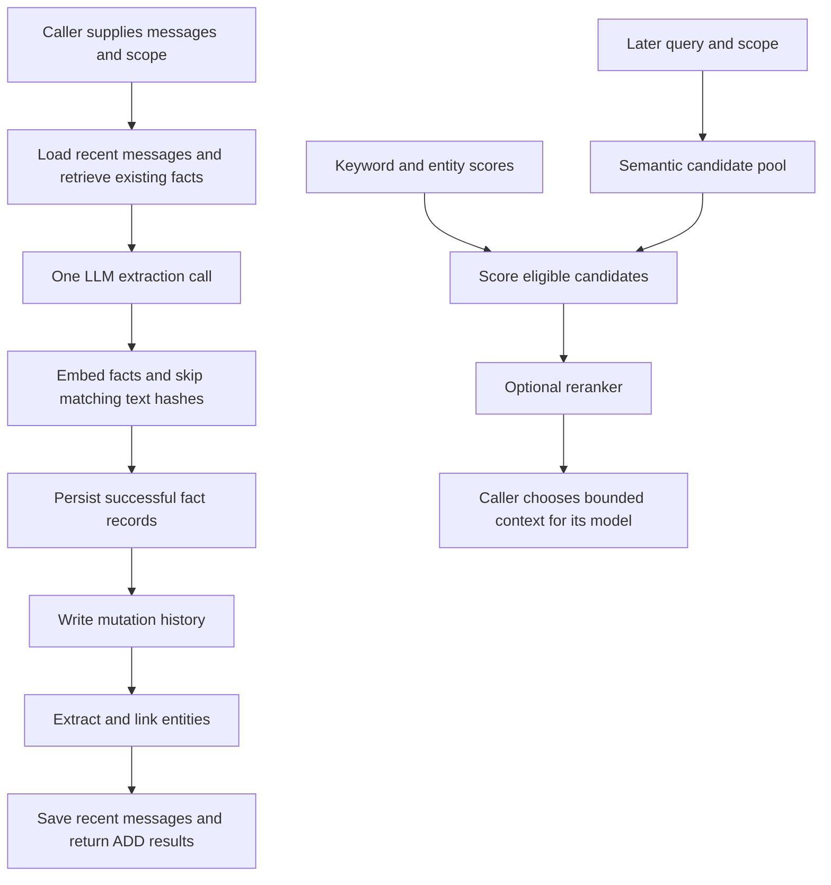

# Mem0 persistent memory research

Research date: 2026-11-05. This follows the [AIRI](AIRI_MEMORY.md) and
[Letta](LETTA_MEMORY.md) investigations and examines the requested
[`mem0ai/mem0` repository][repo]. It is a research reference, not an
implementation plan, an accepted API design, or implemented Cogita behavior.

## Scope and evidence

| Source | Inspected version | Evidence boundary |
| --- | --- | --- |
| Mem0 repository | [`ed1f10fc87080f0b67f99be370817504888462ab`][repo], committed 2026-11-04 | Python OSS engine, prompts, storage, scoring, selected adapters and tests; targeted self-hosted HTTP/auth inspection |
| Mem0 documentation | Documentation sources at that same revision | Published product descriptions, including Platform features; hosted implementation was not audited |
| [Python package declaration][package] | `mem0ai` version `2.2.1`, Apache-2.0 | Package version is distinct from the documentation's **v3 algorithm** label and the default `v1.1` result-format configuration |
| Cogita | `532d1d4e5d1cfa44b4553886d8cf321d6caf07c9` | Local contracts, history checkpoints, Knowledge retrieval and behavioral tests |

Links below pin source and documentation to the inspected revision. GitHub HTML
extraction timed out; the cloned repository supplied the README and documentation.
No Mem0 package, model, server, database service or hosted account was installed
or started. Upstream test assertions were inspected, not executed; benchmark
claims were read, not reproduced. TypeScript implementation parity and every
vector adapter were outside scope. The findings describe the inspected Python paths.

The main finding is that current Mem0 separates **additive fact extraction**
from **retrieval** and, on its managed Platform, **memory lifecycle management**.
It is useful for studying a durable fact service, but its default OSS pipeline
does not supply Cogita's source-version commits, context budget, or complete
correction and forgetting semantics.

## Current architecture and version boundary

The [README][readme] and [migration guide][migration] describe the April 2026
switch from model-selected ADD/UPDATE/DELETE/NONE operations to a single
ADD-only extraction call. The current [engine][main] follows that path.
Older extraction/update prompts and some outdated docstrings remain in the
repository; their presence does not make them the active algorithm.
Explicit `update()` and `delete()` APIs still exist.

| Layer | What it does now | Boundary |
| --- | --- | --- |
| Python `Memory` / `AsyncMemory` | Extract, store, search, update, delete and inspect facts | Library calls; no complete conversation runtime; `chat()` raises `NotImplementedError` |
| Main vector collection | Fact text, embeddings, identity fields, metadata and timestamps | Primary searchable record, separate from SQLite history |
| Entity collection | Extracted names/concepts and linked fact IDs | Optional retrieval signal; not the removed external graph-store integration |
| SQLite history/messages | Fact mutation history and a recent extraction-context buffer | Not a complete original conversation archive or a fact-to-message evidence graph |
| Self-hosted server | HTTP API, dashboard, authentication and request logging | Separate application around the OSS engine, with its own configuration and dependencies |
| `MemoryClient` / `AsyncMemoryClient` | Calls Mem0 Platform HTTP endpoints | Remote service client, not a local engine with equivalent capabilities |
| Platform lifecycle services | Dream, temporal ranking, optional decay and beta profiles | Documented hosted features; not established as OSS implementations |

The [default components][oss-overview] are an OpenAI LLM and embedder, local
Qdrant for library use, and SQLite history. The self-hosted stack defaults to
Postgres/pgvector. Adapters can change these choices; self-hosting the database
does not by itself make inference local.

## Extraction and storage lifecycle

### Input, extraction and deduplication

The normal `infer=True` path in [Memory.add][main] performs these stages:

| Stage | Observed behavior | Implication |
| --- | --- | --- |
| Scope | Requires at least one of `user_id`, `agent_id`, `run_id`; copies supplied identities into records | Caller must select the intended memory owner |
| Recent context | Reads the latest 10 buffered messages under the exact identity combination | Passing only a user ID shares this context across that user's add calls |
| Existing facts | Embeds the new message text and retrieves 10 semantic neighbors in scope | Extraction does not examine the entire store |
| Extraction | One JSON-mode LLM call using current messages, prior context, retrieved facts and optional custom instructions | One extraction call still entails embeddings, storage operations and optional entity work |
| Deduplication | Prompt asks to skip equivalent facts; exact text MD5 is checked against retrieved neighbors and the current batch | No global uniqueness guarantee, semantic equivalence guarantee or retry idempotency key |
| Persistence | Embeds facts in a batch, writes vector records, then SQLite history and entity links | These stages do not share one transaction |
| Recent-message retention | Saves original supplied message fields, retaining at most 10 rows per scope | Context aid, not a durable source archive |

The [active prompt][prompts] asks for self-contained facts, generally 15–80
words, across all meaningful topics. It extracts from **both user and assistant
messages**, while asking the model to distinguish user assertions from
recommendations, confirmations and assistant-provided information.
`attributed_to` is stored when supplied. Agent-only scope adds an agent-perspective
suffix; adding both user and agent IDs does not use that suffix.

This is valuable coverage guidance, but attribution is still model-generated.
It does not prove that an assistant's claimed action succeeded, that a quoted
statement is endorsed, or that a recommendation became the user's preference.
For QQ, source role is also insufficient to identify which participant a fact
concerns. Cogita would need stable speaker, subject and source-message identities.

`infer=False` instead stores each eligible non-system message as a raw memory,
including its role and optional `name` as `actor_id`. It bypasses the normal
extraction, neighbor deduplication, entity-linking and recent-buffer pipeline.
It still embeds and stores text; it is not a switch that disables memory writes.

A separate `procedural_memory` path with an agent ID summarizes a conversation
into a stored procedure-like text. It is not the default fact path or a generated
executable skill, and the source explicitly marks it for future removal.

### Prompt intent is broader than the implemented path

Several differences matter when deciding what to borrow:

- The prompt describes a profile summary and recently extracted facts, but the
  inspected call supplies neither; those sections are empty. It supplies 10
  recent messages, truncated to 300 characters each in the prompt, while new
  input is not similarly bounded by this builder.
- The prompt requests `linked_memory_ids` relating new facts to old facts.
  The OSS add path remaps existing IDs to short integers, does not use the
  reverse mapping, and does not persist the model's returned links. The later
  entity collection's `linked_memory_ids` is a different relationship built
  from entity extraction. Do not describe the prompt's links as implemented
  provenance or supersession edges.
- The builder supports observation dates, but OSS `add(timestamp=...)` rejects
  that Platform parameter. The ordinary call uses today's UTC date for both
  observation and current date. Supplying historical text or a metadata timestamp
  does not establish correct historical anchoring of relative dates.
- The prompt builder has a `use_input_language` option, but the inspected add
  path does not enable it. English prompts and English NLP do not establish
  Chinese extraction or entity quality.
- The engine requests a JSON object, then accepts code-fence/embedded-JSON
  recovery. It does not validate the extraction through a strict fact schema.
  Parsing failures can become an empty extraction while saving recent messages;
  structurally invalid parsed items can fail later. This is weaker than Cogita's
  strict structured-output boundary.

[Message formatting][utils] also flattens supported roles into text: the inferred
path includes system text if supplied and omits message `name` from that text;
tool-role content is not included by `parse_messages`. Callers should construct
an explicit evidence projection instead of sending an unfiltered tool transcript
or relying on prompt examples to preserve group authorship.

### Failure, concurrency and source coverage

The current engine raises `LLMError` when the provider call fails. Vector batch
insertion falls back to individual writes and returns only records whose writes
succeeded. If none succeeds, it saves the recent messages and raises
`VectorStoreError`. [Tests][test-main] explicitly assert these partial-success
boundaries for synchronous and asynchronous paths.

History-write failures may be logged after successful vector writes. Entity
linking is also best effort. Thus a successful returned fact need not have a
complete history or entity index. There is no cross-store atomic commit, no
transaction tied to a successful conversational reply, and no inspected
source-coverage/version precondition equivalent to Cogita's `history_version`.
`AsyncMemory` moves many blocking operations into threads; it is not a durable
job queue or a transaction spanning cancellation and worker completion.

There is a useful [Qdrant update/delete race test][test-main] asserting that an
update which finds its record removed must not recreate it. That targeted
protection is not general optimistic concurrency for two corrections, entity
link merges, repeated add requests, or a new extraction after deletion.

## Retrieval: useful signals and concrete limits

The inspected [search implementation][main] defaults to `top_k=20`,
`threshold=0.1`, and `rerank=False`. Its semantic candidate pool is
`max(top_k * 4, 60)`. Keyword search runs separately; query entities are extracted
and matched against the entity collection to obtain additional boosts.

Crucially, **only semantic results become final candidates**. Keyword-only or
entity-only matches do not add candidates. [Scoring][scoring] first rejects
candidates below the semantic threshold, then combines semantic, normalized
BM25 and entity scores. A keyword boost cannot rescue a fact rejected by that
threshold. [Scoring tests][test-scoring] make this behavior explicit.

The combined score divides the sum by a maximum that depends on which signal
maps are nonempty. It is a relevance score, not factual confidence. The
`explain=True` result exposes the components and threshold, which is useful for
retrieval diagnostics. The public combined score can be below the configured
threshold because the threshold gates the semantic component first.

Entity processing uses optional [spaCy extraction][entity-extraction]. Entities
are matched by normalized text or high embedding similarity and linked to fact
IDs. Query-time boosts are bounded and reduce the contribution of entities
linked to many memories. This can help named subjects but does not implement
typed relations, authoritative identity resolution, or arbitrary graph traversal.

The [NLP loader][spacy] selects `en_core_web_sm` and attempts to download it
when spaCy is installed but that model is missing. Missing NLP falls back to
raw text for keyword processing and no extracted entities. Keyword capability
also depends on the vector adapter: [Qdrant][qdrant] needs its optional fastembed
sparse encoder, while other stores use their own search facilities. It is
therefore inaccurate to promise identical hybrid retrieval for every install.

If configured and requested, reranking applies to the already selected results.
A reranker failure retains original ordering. Cogita already has this fallback
principle and a distinct advantage for keyword recall: its
[retriever](../../ai_workbench/core/retrieval.py) merges vector and keyword
candidates with RRF before optional reranking. Mem0's additive scoring should
not replace it without representative comparative evidence.

Search returns data for the caller to insert into a prompt; the engine does not
budget the complete answering request. A fact count alone is insufficient when
facts have variable lengths or other context consumes most of the model window.

## Ownership, isolation and application integration

The OSS identity fields are filters, not an authorization system. Multiple
provided identifiers constrain a record together; omitting a dimension on a
later search broadens the matching set. A `run_id` has no automatic lifetime:
records remain until a visibility or deletion operation changes them.

[Scope construction][main] escapes separators for the recent-message buffer,
and [tests][test-scope] cover collision resistance. Identity keys in freeform
metadata cannot inject scope on add or change it on update, with corresponding
[regression assertions][test-main]. These are useful application-boundary
rules, but ID-based `get`, `update`, `delete` and `history` calls still need an
owner check from the integrating application.

The inspected [self-hosted routes][server] authenticate callers using
[auth dependencies][auth] and reserve several global operations for admins.
Ordinary memory routes accept supplied scope/record IDs without binding them
to the authenticated account. This is suitable only with an understood trusted
caller boundary; per-user API keys alone do not establish per-memory ownership
isolation. This observation does not describe the hosted Platform's authorization.

The [Platform scope documentation][scope-doc] additionally describes `app_id`
and default extraction that assigns user- versus agent-attributed records to
their respective entity ID. OSS copies the supplied scope combination into each
fact. The two surfaces should not be treated as interchangeable ownership models.

For Cogita, Project access, ordinary-session policy, QQ conversation access,
fact subject and the selected Persona are distinct concerns. In particular,
mapping `agent_id` directly to a reused Persona would not isolate Workspace
Projects or unrelated QQ conversations. Model-proposed metadata must not select
the accessible scope or authorize cross-scope promotion.

## Corrections, expiration and forgetting

ADD-only extraction preserves earlier facts when new facts arrive. For example,
an old residence and a later move may coexist. In the inspected OSS path there
is no automatic current-state resolver or persisted supersession relationship.
Explicit `update(id, text=...)` changes the record, regenerates its embedding and
keyword text, logs old/new text, and attempts to refresh entity links.

| Operation | Observed effect | Retained or unresolved state |
| --- | --- | --- |
| Add a correction as new evidence | Adds another fact unless deduplication skips it | Old fact remains eligible; retrieval must distinguish time and validity |
| Explicit update | Replaces current fact content and records UPDATE history | Previous content remains in SQLite history; no fact-to-source invalidation graph |
| Expiration | Search/list hide facts after an inclusive UTC calendar date; `show_expired=True` reveals them | Direct get still returns the record; storage is unchanged |
| Delete by ID | Removes the primary vector record and writes DELETE history | Old text remains in history; recent-message buffer is not purged |
| Scoped delete-all | Iterates matching fact records | Does not clear matching recent-message buffers or mutation history |
| Reset | Resets history/messages and primary vector collection | Entity reset is conditional on an initialized entity store and failures are logged; not a complete physical-erasure guarantee |

Expiration filtering occurs after bounded candidate fetching, so many expired
records can crowd out active records and yield fewer results than requested.
The existing-fact lookup during add does not apply the ordinary search expiration
filter, so hidden facts can still influence extraction and deduplication.

[Entity cleanup][main] is best effort and skips cleanup when the entity store
has not been initialized in that process. Stale links do not alone return a
deleted fact, because final candidates come from the primary store, but they
are retained derived state. The recent buffer and [history table][storage]
also make deleting a fact different from forgetting its source content.
The system can encounter that content again during later extraction.

These distinctions are essential for a user-facing forget operation: visibility,
validity, active record deletion, evidence removal, revision retention and
protection against stale or repeated writers need separate explicit semantics.

## What the managed Platform adds

These findings come from pinned documentation and client surface inspection,
not a hosted-service acceptance run. The [Platform comparison][comparison]
explicitly distinguishes the following from OSS:

| Feature | Documented behavior | Relevant lesson |
| --- | --- | --- |
| [Asynchronous add][platform-add] | Returns an event ID and PENDING status; poll until SUCCEEDED/FAILED | HTTP acceptance is not searchable-memory completion |
| Temporal Reasoning | Ranks by event dates and query time, with `timestamp` / `reference_date` | Observation time and event time are different from insertion time |
| Memory Decay | Opt-in project ranking multiplier, approximately 0.3–1.5, reinforced when results are returned | Repeated retrieval affects popularity, not truth; decay is not deletion |
| Dream Supersede | Marks old contradictory facts and links replacements; on by default | Preserve evidence while representing current validity explicitly |
| Dream Merge | Retains a canonical fact and marks merged copies; on by default | Deduplication and fact deletion are different operations |
| Dream Synthesis | Optional scheduled pattern memories with source-memory links | Derived claims need inspectable evidence and their own lifecycle |
| [Graph Memory][graph] | Built-in entity connections and ranking boosts; external graph stores removed | Entity association need not require deploying Neo4j |
| Profiles | Beta, request-enabled structured summaries shaped by JSON Schema; asynchronous status | A profile is a derived view, not the original facts or a manually authored Persona |

[Dream][dream] is especially relevant to the ADD-only design: **superseded facts
remain visible by default**, while merged duplicates are hidden. `latest_only`
requests active facts; `include_merged` widens the view. Therefore ADD-only
extraction does not mean the Platform has no later lifecycle processing.
Its synthesis documentation limits eligible inputs to user-only scope and facts
created after enablement; adding agent/run/app scope changes eligibility.
These are significant product semantics, not general guarantees for all memories.

[Expiration][expiration] is available in both OSS and Platform, whereas
[temporal ranking][temporal], [decay][decay], Dream and [profiles][profiles] must
not be inferred from an OSS timestamp field or an SDK method name.

The README's LoCoMo 92.5 and LongMemEval 94.4 scores explicitly describe managed
Platform results with proprietary optimizations, at a `top_200` retrieval budget.
The migration page still cites different figures. Neither set measures this
checkout, Cogita's Chinese/QQ workloads, or an arbitrarily selected local model.
Use the claims as evaluation motivation, not an integration acceptance result.

## Comparison and recommendations for Cogita

| Concern | AIRI main chat | Letta direction | Mem0 OSS | Cogita implication |
| --- | --- | --- | --- | --- |
| Durable unit | Atomic fact entry | Versioned Markdown subjects/skills | Extracted fact with embedding and metadata | Keep a clear fact owner and source identity |
| Discovery | Index then read by ID | Core context plus deferred file discovery | Query-based semantic candidates with extra ranking signals | Combine bounded recall with existing ContextBuilder accounting |
| Automatic writes | Model tools | Agent curation and optional reflection | Caller-triggered extraction | Decide trigger and commit policy separately from extraction |
| Contradictions | Lightweight edit/forget | Curated edits and Git history | Additive facts; explicit update/delete | Define current validity and correction rules |
| Provenance | Limited per-entry metadata | Prompted source references and commits | Optional metadata/attribution; separate change history | Prefer structured links to actual messages and confirmed outcomes |
| Default extra infrastructure | Browser store | Files/Git | Embeddings, vector store, SQLite; optional NLP/entity collection | Reuse Cogita services before introducing another stack |

Cogita's [Chat/context](../contracts/chat-context.md),
[Harness/tools](../contracts/harness-tools.md#on-demand-history),
[Knowledge](../contracts/knowledge.md) and [QQBot](../contracts/qqbot.md)
contracts remain the implementation owners. Current
[history checkpoints](../../ai_workbench/core/history_retrieval.py) are
session working memory, not an independent cross-session fact store.
[Tests](../../tests/test_history_retrieval.py) cover candidate preservation and
history-version conflicts; [Knowledge tests](../../tests/test_phase2a_knowledge.py)
cover shared model inference, invalidation and reranker fallback.

The following are research recommendations, not scheduled work:

1. Borrow the extraction/retrieval separation and self-contained facts. Make
   extraction a strict, bounded candidate-producing operation; choose durable
   facts selectively rather than copying the prompt's exhaustive capture policy.
2. Preserve the distinction between user assertions, assistant suggestions,
   confirmed tool outcomes and derived patterns. Store stable source IDs,
   subject/scope, observation/event times and revision information; keep learned
   content below instruction authority.
3. Prefer explicit correction and supersession semantics over blindly adopting
   ADD-only storage. New historical events can be additive while a changed
   preference has an identifiable current value. Keep inspection, correction
   and forgetting understandable to the user.
4. Reuse current Knowledge retrieval primitives and ModelManager. Evaluate fact
   granularity and candidate recall first; add entity boosting only if Chinese,
   mixed-language and QQ subject tests show an improvement. Preserve RRF order
   when reranking is unavailable.
5. Extend the existing source-version commit approach to any future durable
   facts. Commit content and references consistently, expose partial extraction
   outcomes, and prevent stale jobs or replayed evidence from resurrecting
   forgotten facts. A ten-message buffer is not sufficient provenance.
6. Keep full-request token budgets, explicit inference model selection and
   cancellation under Cogita's existing services. Default Mem0 providers,
   embedding/reranker factories, automatic spaCy model downloads and default-on
   [telemetry][telemetry] should not enter the application incidentally.
7. Do not adopt the hosted Mem0 API as an ordinary model provider: it is a
   separate memory protocol, not OpenAI-compatible inference. Current project
   constraints favor implementing selected ideas through `core/models` and
   existing local APIs. Neither a new memory daemon nor an upstream adapter
   registry is justified by this investigation.

Background synthesis, adaptive decay and generated profiles should follow
successful foreground lifecycle acceptance. Scope ownership, read/write
switches, history-off behavior, operation without Harness, selected extraction
model and the precise retention promise remain product decisions. No new API,
setting, dependency, default or background process is introduced by this report.

### Meaningful future acceptance

| Scenario | Required observation |
| --- | --- |
| New session in the same permitted scope | Durable relevant facts survive without importing unrelated sessions |
| Same Persona across different Projects or QQ conversations | No cross-scope recall or wrong participant attribution |
| User corrects a preference or reports a dated change | Current and historical questions select the appropriate evidence |
| Assistant suggestion, quoted text, web result or failed action | No conversion into an unsupported user fact or confirmed outcome |
| Chinese names, aliases and mixed-language queries | Measured extraction and retrieval quality; no assumed English-NLP parity |
| Keyword-only match outside the semantic pool | Candidate recall remains measurable and does not disappear silently |
| Invalid extraction, partial insert or cancellation | Failure is distinguishable from no new facts; coverage advances only as specified |
| Retry, concurrent correction, source edit and deletion | No duplicate committed event, lost correction or stale resurrection |
| Expiration and forget | Search, direct reads, evidence, revisions and derived indexes obey distinct documented rules |
| Large fact store or long input | Extraction and answering fit budgets, including retrieved context and optional reranking |
| Future pattern/profile generation | Derived assertions identify supporting facts and respond correctly to source changes |

Measure supported-fact recall, stale answers, attribution errors, unwanted
writes, cross-scope exposure, candidate omissions, extra calls/tokens and latency.
Inspected upstream tests substantiate intended mechanisms, not real-model
quality or hosted benchmark reproducibility.

[repo]: https://github.com/mem0ai/mem0/tree/ed1f10fc87080f0b67f99be370817504888462ab
[readme]: https://github.com/mem0ai/mem0/blob/ed1f10fc87080f0b67f99be370817504888462ab/README.md
[package]: https://github.com/mem0ai/mem0/blob/ed1f10fc87080f0b67f99be370817504888462ab/pyproject.toml
[migration]: https://github.com/mem0ai/mem0/blob/ed1f10fc87080f0b67f99be370817504888462ab/docs/migration/oss-v2-to-v3.mdx
[oss-overview]: https://github.com/mem0ai/mem0/blob/ed1f10fc87080f0b67f99be370817504888462ab/docs/open-source/overview.mdx
[main]: https://github.com/mem0ai/mem0/blob/ed1f10fc87080f0b67f99be370817504888462ab/mem0/memory/main.py
[prompts]: https://github.com/mem0ai/mem0/blob/ed1f10fc87080f0b67f99be370817504888462ab/mem0/configs/prompts.py
[utils]: https://github.com/mem0ai/mem0/blob/ed1f10fc87080f0b67f99be370817504888462ab/mem0/memory/utils.py
[storage]: https://github.com/mem0ai/mem0/blob/ed1f10fc87080f0b67f99be370817504888462ab/mem0/memory/storage.py
[scoring]: https://github.com/mem0ai/mem0/blob/ed1f10fc87080f0b67f99be370817504888462ab/mem0/utils/scoring.py
[entity-extraction]: https://github.com/mem0ai/mem0/blob/ed1f10fc87080f0b67f99be370817504888462ab/mem0/utils/entity_extraction.py
[spacy]: https://github.com/mem0ai/mem0/blob/ed1f10fc87080f0b67f99be370817504888462ab/mem0/utils/spacy_models.py
[qdrant]: https://github.com/mem0ai/mem0/blob/ed1f10fc87080f0b67f99be370817504888462ab/mem0/vector_stores/qdrant.py
[telemetry]: https://github.com/mem0ai/mem0/blob/ed1f10fc87080f0b67f99be370817504888462ab/mem0/memory/telemetry.py
[server]: https://github.com/mem0ai/mem0/blob/ed1f10fc87080f0b67f99be370817504888462ab/server/main.py
[auth]: https://github.com/mem0ai/mem0/blob/ed1f10fc87080f0b67f99be370817504888462ab/server/auth.py
[test-main]: https://github.com/mem0ai/mem0/blob/ed1f10fc87080f0b67f99be370817504888462ab/tests/memory/test_main.py
[test-scoring]: https://github.com/mem0ai/mem0/blob/ed1f10fc87080f0b67f99be370817504888462ab/tests/utils/test_scoring.py
[test-scope]: https://github.com/mem0ai/mem0/blob/ed1f10fc87080f0b67f99be370817504888462ab/tests/memory/test_session_scope.py
[scope-doc]: https://github.com/mem0ai/mem0/blob/ed1f10fc87080f0b67f99be370817504888462ab/docs/platform/features/entity-scoped-memory.mdx
[comparison]: https://github.com/mem0ai/mem0/blob/ed1f10fc87080f0b67f99be370817504888462ab/docs/platform/platform-vs-oss.mdx
[platform-add]: https://github.com/mem0ai/mem0/blob/ed1f10fc87080f0b67f99be370817504888462ab/docs/api-reference/memory/add-memories.mdx
[graph]: https://github.com/mem0ai/mem0/blob/ed1f10fc87080f0b67f99be370817504888462ab/docs/platform/features/graph-memory.mdx
[dream]: https://github.com/mem0ai/mem0/blob/ed1f10fc87080f0b67f99be370817504888462ab/docs/platform/features/dream.mdx
[expiration]: https://github.com/mem0ai/mem0/blob/ed1f10fc87080f0b67f99be370817504888462ab/docs/platform/features/memory-expiration.mdx
[temporal]: https://github.com/mem0ai/mem0/blob/ed1f10fc87080f0b67f99be370817504888462ab/docs/platform/features/temporal-reasoning.mdx
[decay]: https://github.com/mem0ai/mem0/blob/ed1f10fc87080f0b67f99be370817504888462ab/docs/platform/features/memory-decay.mdx
[profiles]: https://github.com/mem0ai/mem0/blob/ed1f10fc87080f0b67f99be370817504888462ab/docs/platform/features/user-profiles.mdx
